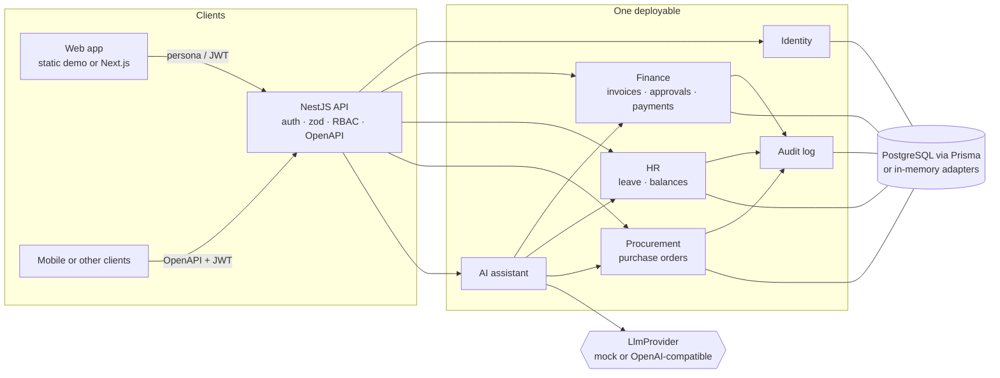

# Enterprise ERP + AI PoC

**Live demo: https://enterprise-erp-ai-poc.web.app** (static browser build, fictional data)

An independent proof of concept by Mohamed Abo Elmagd for a **self-hosted, multi-tenant enterprise
application**: **finance** (supplier invoices, approval, payment), **HR** (leave requests and
balances), **procurement** (purchase orders), an append-only **audit log**, and an **AI assistant**
with a pluggable LLM port. The default provider is a deterministic offline mock — no API keys, no
network — so the same prompt always produces the same structured result. A production deployment
can point the same interface at a model you run yourself.

NestJS + Prisma/PostgreSQL on the API, Next.js (TypeScript) for the web app. **All organisations,
people and numbers are fictional.** Names are marked `(sample)`.

### About the live demo

Firebase Hosting is static, so the live site runs the **real domain services in your browser**:
`createInMemoryPlatform()` wires finance, HR, procurement and the assistant to in-memory
repositories with the same semantics as the Prisma adapter (tenant scoping, version checks, audit).
Nothing is mocked or copied. Switch persona in the top-right corner. Things to try:

1. **Dashboard** as Amira Saleh (finance manager): one overdue invoice, one invoice waiting for approval.
2. **Finance → INV-2026-0001** is overdue (due 20 October, clock frozen at 11 November 2026). **INV-2026-0002** is submitted by Karim; approve it, or switch to Karim and confirm the Approve button is gone.
3. **HR** as Lina Haddad: approve Youssef Farid's December leave and watch his remaining annual balance drop from 16 days to 11. Youssef cannot approve his own request.
4. **Procurement → PO-2026-0001**: submitted by Hadi; approve and issue as Nour.
5. **AI assistant**: type `overdue invoices over 5000`, or paste the sample invoice text and extract vendor, dates, VAT and lines, then create a draft. The provider badge stays `mock`.
6. Switch to **Rania Adel** at Harbor Municipal Works (sample) — Meridian invoices disappear (tenant isolation). Toggle **عربي** for a right-to-left chrome.

Advance the clock with **+1 day** if you want more invoices to fall overdue.

## What it covers

| Area | In this repo |
|---|---|
| TypeScript, design patterns | Aggregates with state machines (`Invoice`, `LeaveRequest`, `PurchaseOrder`), ports & adapters (`Repositories`), Strategy (`LlmProvider`), composition root (`platform.ts`) shared by API and UI |
| PostgreSQL / Prisma | Relational schema with tenant-scoped unique numbers, cascading line items, leave balances, append-only audit, sequence table. `docker compose` runs migrations on boot |
| NestJS REST APIs | NestJS 11, zod validation, JWT access tokens, helmet, `x-request-id`, **OpenAPI** at `/docs` when the API is running |
| Service boundaries | Modular monolith: identity, finance, HR, procurement, audit, AI. See [ADR-0001](docs/adr/0001-modular-monolith.md) |
| AuthN / AuthZ | Role → permission matrix, tenant scoping from the token (never a client header), segregation of duties (the submitter cannot approve) |
| Finance | Draft → submitted → approved/rejected → paid; VAT in basis points; integer minor units (fils); overdue = unpaid and past due |
| HR | Working-day leave, annual balances, overlap checks, employees see only their own requests |
| Procurement | Purchase orders with the same approval shape, then issue to the vendor |
| AI assistant | `parse_report_filter` and `extract_invoice_fields`; mock provider plus an optional OpenAI-compatible adapter. See [ADR-0002](docs/adr/0002-pluggable-llm.md) |
| Next.js frontend | Static export, persona switcher, Arabic/RTL chrome, data-dense tables, in-browser platform |
| Tests | **37 tests**: 28 backend unit, 5 API (supertest against Nest + in-memory platform), 4 React component tests (Testing Library) |
| Delivery | Dockerfile, docker-compose (Postgres 16 + API), GitHub Actions on Node 22, Firebase Hosting demo |
| Security & residency | [docs/SECURITY.md](docs/SECURITY.md) (OWASP-aligned controls, on-prem data residency, LLM egress warning) |
| Decisions | [ADRs](docs/adr) |

## Architecture



## Quick start

```bash
# API (in-memory, no database) + web
npm run setup
npm run dev:api      # http://localhost:3000  — OpenAPI at /docs
npm run dev:web      # http://localhost:3000 of Next, or the next dev port
```

Seed users all share the password `demo-pass-sample` (documented, fictional):

| Email | Role |
|---|---|
| amira.saleh@meridian-civic.example | Finance manager |
| karim.nassar@meridian-civic.example | Finance clerk |
| lina.haddad@meridian-civic.example | HR manager |
| youssef.farid@meridian-civic.example | Employee |
| nour.elmasry@meridian-civic.example | Procurement manager |
| hadi.mansour@meridian-civic.example | Procurement clerk |
| samir.qureshi@meridian-civic.example | Tenant admin |
| rania.adel@harbor-works.example | Finance manager, other tenant |

### Self-hosted (PostgreSQL)

```bash
cp .env.example .env   # set JWT_SECRET
docker compose up --build
# API on http://localhost:3000  (SEED_DEMO=true loads the fictional tenants)
```

`LLM_PROVIDER` defaults to `mock`. To attach a local model server instead:

```
LLM_PROVIDER=openai-compatible
OPENAI_BASE_URL=http://localhost:11434/v1
OPENAI_API_KEY=local
OPENAI_MODEL=llama3.1
```

Read [docs/SECURITY.md](docs/SECURITY.md) before pointing that URL at a third party — prompts may include business data.

## Tests

```bash
npm test        # backend unit + API, frontend component tests
npm run typecheck
```

CI also builds the API, the static Next.js export, and the API Docker image.

## Licence

MIT © 2026 Mohamed Abo Elmagd
